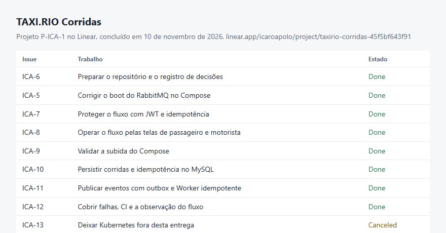
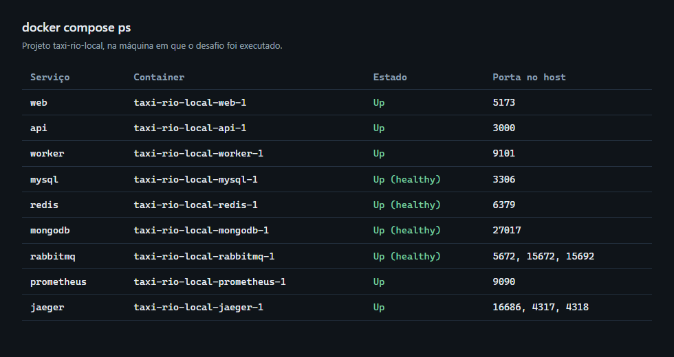
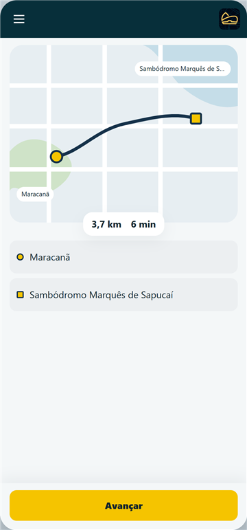
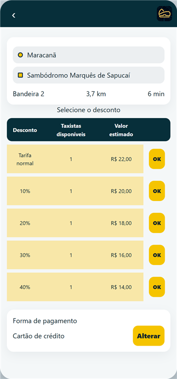
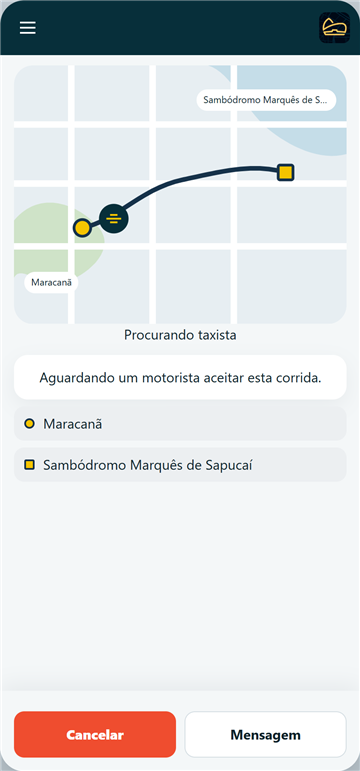
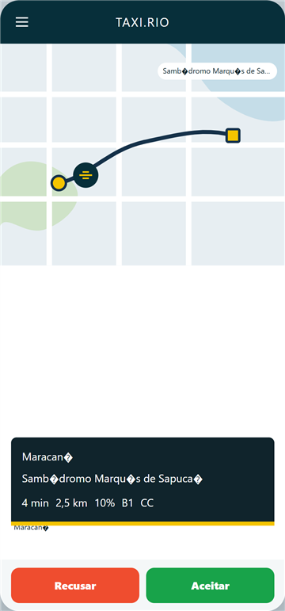
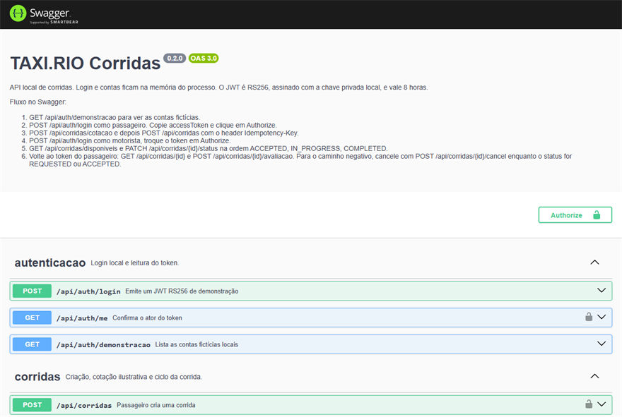
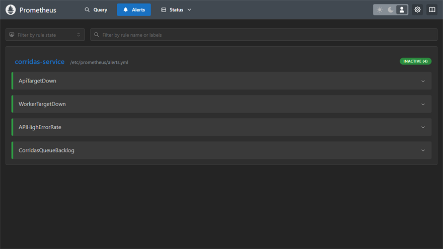

# TAXI.RIO — Corridas

[](https://github.com/IcaroApoloBR/taxi-rio-code-challenge/actions/workflows/ci.yml)

Serviço de corridas do desafio técnico. O passageiro pede, o motorista aceita e avança o status, e o Worker registra o histórico. MySQL guarda a corrida, a idempotência e o outbox. MongoDB guarda o histórico. Redis guarda a projeção de status.

## Links

Estes endereços abrem direto:

| Onde | Link |
| --- | --- |
| Repositório | https://github.com/IcaroApoloBR/taxi-rio-code-challenge |
| Linear, projeto TAXI.RIO Corridas | https://linear.app/icaroapolo/project/taxirio-corridas-45f5bf643f91 |
| GitHub Actions | https://github.com/IcaroApoloBR/taxi-rio-code-challenge/actions/workflows/ci.yml |
| Compose | https://github.com/IcaroApoloBR/taxi-rio-code-challenge/blob/main/docker-compose.yml |
| Docker Compose | https://docs.docker.com/compose/ |
| Imagens oficiais | [MySQL](https://hub.docker.com/_/mysql), [Redis](https://hub.docker.com/_/redis), [MongoDB](https://hub.docker.com/_/mongo), [RabbitMQ](https://hub.docker.com/_/rabbitmq), [Prometheus](https://hub.docker.com/r/prom/prometheus), [Jaeger](https://hub.docker.com/r/jaegertracing/all-in-one), [k6](https://hub.docker.com/r/grafana/k6) |

Swagger, interface, Prometheus, Jaeger e RabbitMQ sobem na máquina de quem executa o Compose. O navegador usa `localhost` porque as portas são publicadas no host. Dentro da rede do Compose os serviços se chamam pelos nomes `api`, `worker`, `mysql`, `redis`, `mongodb`, `rabbitmq` e `jaeger`. O `127.0.0.1` do `.env.example` vale só para a API rodando fora dos containers. O Compose sobrescreve esses hosts.

| Depois do Compose | Endereço no navegador |
| --- | --- |
| Interface | http://localhost:5173 |
| Swagger | http://localhost:3000/api/docs |
| Health | http://localhost:3000/api/health |
| Métricas da API | http://localhost:3000/api/metrics |
| Métricas do Worker | http://localhost:9101/metrics |
| Prometheus, alertas em `/alerts` | http://localhost:9090 |
| Jaeger | http://localhost:16686 |
| RabbitMQ, usuário `local_rabbit`, senha `local_rabbit_password` | http://localhost:15672 |





As issues: [ICA-6](https://linear.app/icaroapolo/issue/ICA-6/preparar-o-repositorio-e-o-registro-de-decisoes), [ICA-5](https://linear.app/icaroapolo/issue/ICA-5/corrigir-o-boot-do-rabbitmq-no-compose), [ICA-7](https://linear.app/icaroapolo/issue/ICA-7/proteger-o-fluxo-de-corrida-com-jwt-e-idempotencia), [ICA-8](https://linear.app/icaroapolo/issue/ICA-8/operar-o-fluxo-pelas-telas-de-passageiro-e-motorista), [ICA-9](https://linear.app/icaroapolo/issue/ICA-9/validar-a-subida-do-compose), [ICA-10](https://linear.app/icaroapolo/issue/ICA-10/persistir-corridas-e-idempotencia-no-mysql), [ICA-11](https://linear.app/icaroapolo/issue/ICA-11/publicar-eventos-com-outbox-e-worker-idempotente), [ICA-12](https://linear.app/icaroapolo/issue/ICA-12/cobrir-falhas-ci-e-a-observacao-do-fluxo) e [ICA-13](https://linear.app/icaroapolo/issue/ICA-13/deixar-kubernetes-fora-desta-entrega).

## Como subir

Na raiz do repositório, com Docker Desktop ou Docker Engine e Compose:

```bash
cp .env.example .env
docker compose up --build
```

A primeira subida constrói API, Worker e interface. As contas de login ficam na memória do processo da API. Corrida, idempotência e outbox vão para o MySQL. As senhas do `.env.example` são fictícias: MySQL `corridas` / `local_corridas_password`, Redis `local_redis_password`, Mongo `local_admin` / `local_mongo_password`.

O par JWT de demonstração já está em `keys/`. Ele só assina o emissor `taxi-rio-local`. O login usa essa chave. Sem ela, `POST /api/auth/login` responde 503.

## Contas de demonstração

O botão **Preencher conta de demonstração** preenche a primeira conta. `GET /api/auth/demonstracao` lista as mesmas.

| Papel | Acesso | Senha ou telefone |
| --- | --- | --- |
| Passageira Ana | `ana@demo.taxi.rio` | `(21) 98888-1001` |
| Passageiro Bruno | `bruno@demo.taxi.rio` | `(21) 98888-1002` |
| Motorista | RATR `100001` | `demo-livre` |
| Segundo motorista | RATR `100002` | `demo-livre` |

Um e-mail novo no login de passageiro cria uma conta na memória do processo. Reiniciar a API apaga essas contas novas. Ana, Bruno e os dois motoristas voltam com o processo.

## Testar na interface

Abra http://localhost:5173 em duas janelas. Cada uma guarda o próprio token.

1. Na primeira, entre com a Ana.
2. Mantenha Maracanã → Sambódromo Marquês de Sapucaí e toque em **Avançar**. A cotação vem de `POST /api/corridas/cotacao`.
3. Escolha um desconto e a forma de pagamento. **OK** cria a corrida.
4. Na segunda, entre com o RATR `100001`. Em **Livre**, a oferta aparece quando o desconto cabe no máximo do motorista e o pagamento está aceito. Cartão de débito começa desligado. Dinheiro permanece obrigatório.
5. **Aceitar**, **Iniciar corrida** e **Finalizar corrida**. A janela da Ana atualiza sozinha a cada 3 segundos e pede a avaliação no fim.
6. **Minhas corridas** lista o histórico dela. **Cancelar** vale enquanto a corrida está pedida ou aceita.

<p>
  
  
  
  
  
</p>

O motorista `100002` recebe `409` se tentar avançar a corrida que o `100001` já aceitou. O mesmo motorista recebe `409` com código `DRIVER_BUSY` se aceitar outra corrida antes de encerrar a atual.

A cotação muda com a origem e o destino. Há duas rotas de referência e, para os outros endereços, uma estimativa determinística. Os valores são de demonstração.

## Swagger

http://localhost:3000/api/docs abre depois do Compose. O login devolve HTTP 200 e um JWT RS256, válido por 8 horas.

1. `GET /api/auth/demonstracao`
2. `POST /api/auth/login` como passageiro. Copie o `accessToken` e use **Authorize**.
3. `POST /api/corridas/cotacao` e `POST /api/corridas` com o header `Idempotency-Key`.
4. `POST /api/auth/login` como motorista e troque o token.
5. `GET /api/corridas/disponiveis` e `PATCH /api/corridas/{id}/status` na ordem `ACCEPTED`, `IN_PROGRESS`, `COMPLETED`.
6. Volte ao token da Ana: `GET /api/corridas/{id}` e `POST /api/corridas/{id}/avaliacao`.

Sem token, ou com token inválido, a resposta é `401`. Passageiro não muda status. Motorista não cria corrida nem lê a de outro passageiro. Esses casos respondem `403`. A mesma `Idempotency-Key` com o mesmo corpo devolve a corrida original. A mesma chave com outro corpo responde `409` e código `IDEMPOTENCY_CONFLICT`.



## Acompanhar uma corrida

O header `X-Correlation-Id` da resposta é o valor dos logs. Ele é diferente do `trace_id`.

1. Crie a corrida e guarde o header e o `trace_id` do log JSON da API (`docker compose logs api`).
2. No Jaeger, serviço `api`, abra o span `POST /api/corridas` pelo atributo `correlation_id`.
3. O span `mysql ride transaction` é filho desse HTTP. O span `publish outbox event` abre outro trace e aponta para a transação com `FOLLOWS_FROM`.
4. No serviço `worker`, o span `consume corridas.history` aponta para a publicação com `FOLLOWS_FROM`. A gravação no MongoDB é filha do consumo.

Exemplo de 2026-11-10: corrida `c527cc71-640a-46c0-8b85-76dd56c3e6dc`, correlation `corrida-trace-link`, trace HTTP `ec4607b4019a5faafd8cfe20302a1998`.

As métricas da API são `http_requests_total`, `http_request_duration_seconds`, `http_request_errors_total` e `corridas_oldest_message_age_seconds`. As do Worker são `worker_events_processed_total`, `worker_events_failed_total` e `worker_event_processing_duration_seconds`. O rótulo de rota é o template.

O Prometheus carrega `APIHighErrorRate` e `CorridasQueueBacklog`, além de `ApiTargetDown` e `WorkerTargetDown`, a partir de `observability/alerts.yml`. O mesmo grupo está em `observability/alerts-prometheusrule.yaml`. O detalhe está em `docs/observability.md`.



## Testes, CI e carga

O workflow [`.github/workflows/ci.yml`](.github/workflows/ci.yml) roda em push e pull request: instala com pnpm 9.15.4 e Node 22, faz lint, testa em memória e constrói as imagens da API, do Worker e da interface. Os testes não recebem `MYSQL_HOST`, `REDIS_HOST`, `RABBITMQ_URL` nem `MONGO_URL`, para continuarem nos repositórios em memória.

Na raiz, com as mesmas versões:

```bash
pnpm install
pnpm lint
pnpm test
```

O k6 está em `load/create-ride.js`. Com a API no ar:

```bash
docker run --rm \
  -e API_BASE_URL=http://host.docker.internal:3000 \
  -v "$PWD/load:/scripts" \
  grafana/k6 run /scripts/create-ride.js
```

No Git Bash, prefixe com `MSYS_NO_PATHCONV=1` para o destino `/scripts` não ser reescrito. A execução de 2026-11-10 fez 672 requisições, 0% de erro e p95 de 73,51 ms. O relatório está em `docs/load-test.md`.

## Tecnologias

| Peça | Uso |
| --- | --- |
| Node.js 22 e pnpm 9.15.4 | Imagens e CI |
| NestJS 10 | API, JWT RS256 e Swagger |
| React 18 e Vite 6 | Interface. A autorização fica na API |
| MySQL 8.4 | Corrida, idempotência e outbox |
| Redis 7.4 | Projeção `ride:{id}:status`, TTL de 300 segundos |
| MongoDB 8 | Histórico `ride_events` |
| RabbitMQ 4 | Publicação, retry e dead-letter |
| Prometheus e Jaeger | Métricas e trace OpenTelemetry |
| k6 | Carga curta |
| GitHub Actions | Lint, teste e build das imagens |

Registro do trabalho: `DECISIONS.md`, `DIARIO.md`, `LIMITES.md` e `docs/architecture.md`.

## Mapa do repositório

| Caminho | Conteúdo |
| --- | --- |
| `docker-compose.yml` | API, Worker, interface, MySQL, Redis, MongoDB, RabbitMQ, Prometheus e Jaeger |
| `apps/api` | HTTP, JWT, corridas, outbox e métricas |
| `apps/worker` | Consumo, MongoDB, Redis e dead-letter |
| `apps/web` | Telas de passageiro e motorista |
| `observability/` | Scrape e alertas |
| `load/create-ride.js` | Cenário de k6 |
| `.github/workflows/ci.yml` | Pipeline |

## Declaração de uso de IA

Usei o Cursor, com o agente de código, para implementar a API, o Worker, a interface, a observação, os testes e esta documentação. As decisões foram revisadas contra o que a aplicação faz.

Uma sugestão foi recusada: tratar o consumo do Worker como filho do span HTTP. O processamento acontece depois da resposta, então a publicação e o consumo abrem traces próprios e se ligam com `FOLLOWS_FROM`.

Outra saída foi corrigida depois de conferida no Jaeger. Sem o gerenciador de contexto assíncrono, cada span saía num trace separado. A correção foi instalar `@opentelemetry/context-async-hooks`. O construtor de `BatchSpanProcessor` desta versão recebe um objeto `{ exporter, scheduledDelayMillis }`, e o scrape do RabbitMQ passou para `/metrics/per-object` porque o endpoint agregado não traz o nome da fila.
